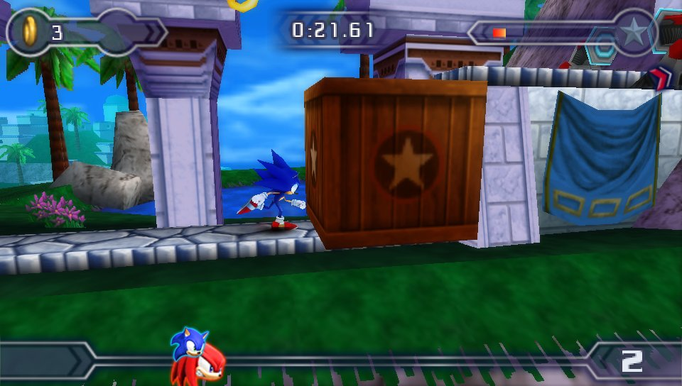
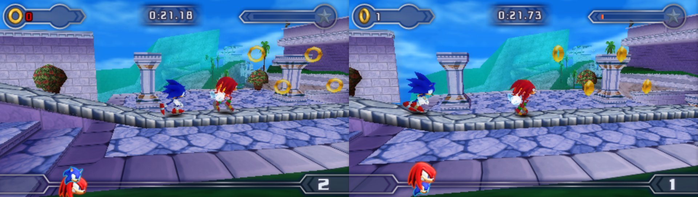
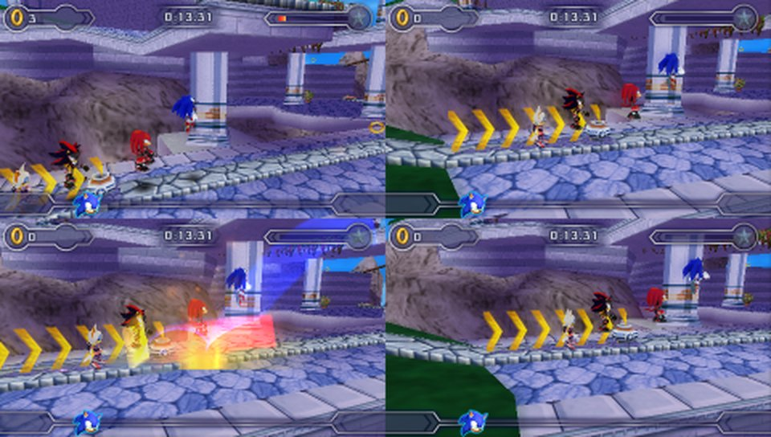
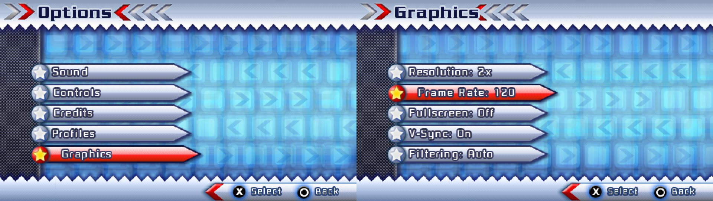

# Sonic Ultimate Rivals: Sonic Rivals 2 for PC

A native PC port of **Sonic Rivals 2** (PSP, 2007) for Linux, Windows and macOS, made by static
recompilation: the game's own code is translated into C and compiled for your computer, so it runs natively
instead of in an emulator. It adds higher frame rates (60 to 240 fps), higher resolutions, widescreen
windows, controller support, split-screen multiplayer for up to four players on one PC, mods and texture
packs.



| Two players, split screen | Four players in one race |
|---|---|
|  |  |



**Features**
- The whole game: story, races, battles, boss stages, cutscenes and videos, with its own menus and saves.
- 60, 120, 144, 165 or 240 fps (the PSP ran races at 30), 1x to 8x resolution, fullscreen, V-Sync and
  texture filtering, set from a new Graphics entry in the game's own Options screen.
- Controllers (Xbox/PlayStation layouts via SDL) and keyboard.
- Multiplayer on one PC: two-player Wireless Play in split screen, and races, battles and boss stages with
  two to four players (or computer players) in one game.
- Mods: replace any game file or texture, character skins, texture dumping.

> **You need your own copy of the game.** Apart from the screenshots above, this repository contains no game files, no game code and no
> game assets. The build reads the program from your own disc image, and the port loads the levels, music
> and videos from it when it runs. Builds made from it contain code derived from your copy of the game:
> keep them for your own use and don't share them.

## What you need

1. **A dump of your own Sonic Rivals 2 UMD as a plain `.iso`**, the **USA release (ULUS10323)**. Other
   releases have different code and won't work. On a PSP with custom firmware, the UMD can be copied to a
   memory stick as an ISO (for example from the custom firmware's VSH menu, "USB device: UMD Disc"). CSO,
   ZSO or CHD images must be converted back to ISO first. A typical image is 515,866,624 bytes.
2. About 2 GB of free disk space, Python 3, and the build tools for your system (below). A build takes a few
   minutes.

Nothing else from the disc is needed: the disc's `EBOOT.BIN` is encrypted, but it carries the same program
unencrypted as `BOOT.BIN`, which is what gets recompiled.

## Build

The same command works on every system. It unpacks your ISO into a `game` folder here (once), recompiles
the game and builds the program:

```sh
./build.sh "/path/to/Sonic Rivals 2.iso"
```

The result is `build/sr2recomp` (`build\sr2recomp.exe` on Windows). If you already have the disc's files
unpacked (a folder with `PSP_GAME` in it), pass that folder instead of the ISO.

### Linux

```sh
# Debian / Ubuntu
sudo apt install git build-essential pkg-config python3 libsdl2-dev libavcodec-dev \
  libavutil-dev libpng-dev zlib1g-dev
# Fedora:  sudo dnf install git gcc-c++ pkgconf python3 SDL2-devel ffmpeg-free-devel libpng-devel zlib-devel
# Arch:    sudo pacman -S git base-devel python sdl2 ffmpeg libpng zlib

git clone https://github.com/JackyPendrag0n/Sonic-Ultimate-Rivals.git
cd Sonic-Ultimate-Rivals
./build.sh ~/Games/SonicRivals2.iso
build/sr2recomp
```

### Windows

Builds use [MSYS2](https://www.msys2.org), a free set of the GCC tools for Windows.

1. Install MSYS2 from https://www.msys2.org and open **MSYS2 UCRT64** from the Start menu.
2. Install the tools and libraries:
   ```sh
   pacman -S --needed git python mingw-w64-ucrt-x86_64-gcc mingw-w64-ucrt-x86_64-pkgconf \
     mingw-w64-ucrt-x86_64-SDL2 mingw-w64-ucrt-x86_64-ffmpeg mingw-w64-ucrt-x86_64-libpng mingw-w64-ucrt-x86_64-zlib
   ```
3. Get the code and build it. Windows paths are written with forward slashes in this shell (`C:\Games` is
   `/c/Games`):
   ```sh
   git clone https://github.com/JackyPendrag0n/Sonic-Ultimate-Rivals.git
   cd Sonic-Ultimate-Rivals
   ./build.sh "/c/Games/Sonic Rivals 2.iso"
   ```
4. `build` now holds `sr2recomp.exe` and the DLLs it needs. Run it from the shell (`build/sr2recomp.exe`)
   or double-click it in Explorer: it finds the `game` folder next to the repository by itself. To move it
   somewhere else, copy `build\sr2recomp.exe`, the `.dll` files and the `game` folder together.

**Making the .exe on Linux instead:** `tools/cross-windows.sh "/path/to/Sonic Rivals 2.iso"` cross-compiles
with MinGW-w64 (`sudo apt install mingw-w64 nasm curl make`). The first run downloads and builds the
Windows libraries; the result is a single `build/sr2recomp.exe` with no DLLs.

### macOS

Needs the Xcode command line tools and [Homebrew](https://brew.sh). Apple Silicon and Intel Macs both work
(the build compiles for the Mac it runs on).

```sh
xcode-select --install
brew install git python pkg-config sdl2 ffmpeg libpng
git clone https://github.com/JackyPendrag0n/Sonic-Ultimate-Rivals.git
cd Sonic-Ultimate-Rivals
./build.sh ~/Downloads/SonicRivals2.iso
build/sr2recomp
```

macOS support is new: the code compiles for both Mac CPUs and the CI builds it on every push, but it hasn't
been played on a real Mac yet. Please open an issue with the log if something is off.

## Run

`build/sr2recomp` with no argument looks for the game in the current folder, in `game`, and next to the
program. You can also pass the folder, or a `.iso`, which is unpacked once into `game` next to the program
(on Windows you can drop the ISO onto `sr2recomp.exe`).

| | Linux / macOS | Windows |
|---|---|---|
| Settings | `~/.config/sr2recomp/settings.ini` | `%APPDATA%\sr2recomp\settings.ini` |
| Saves, mods, texture dumps | `~/.local/share/sr2recomp/` | `%APPDATA%\sr2recomp\` |

Saves are in `PSP/SAVEDATA` there, in the same format as on a PSP: copy the `ULUS10323RVSAVEDATA*` folders
to or from a PSP's memory stick or PPSSPP's `memstick/PSP/SAVEDATA` to carry your progress over.

### Controls

Controller: left stick / d-pad move, A jump, B / X / Y are the PSP's circle / square / triangle, LB/LT = L,
RB/RT = R, Start, Back = Select.

Keyboard: WASD or arrows move, Space or K jump, L circle, J square, I triangle, Q / E = L / R, Enter Start,
Backspace Select.

PC keys: **F1 / Esc** PC settings, **F9** start/stop player 2 (split screen), F10 save the 3D scene as OBJ,
F11 fullscreen, F12 screenshot.

### Settings

The game's Options screen has a fifth entry, **Graphics**: resolution, frame rate (30, 60, 120, 144, 165 or
240 fps), fullscreen, V-Sync and filtering. F1 opens the same settings over the game, with window, audio
and multiplayer options. F1 > Graphics > Renderer switches between OpenGL (the default) and Vulkan, which
draws the same picture through the Vulkan driver (restart to switch; it falls back to OpenGL by itself where
the drivers don't support it).

### Multiplayer on one PC

- **Two players, Wireless Play:** press F9 (or F1 > 2 Players). A second copy of the game opens in the other
  half of the window, and the two race through the game's own Wireless Play: both choose Multiplayer >
  Wireless Play, player 1 picks Create, player 2 picks Join. Player 2 has their own save data.
- **Up to four players in one game:** on the game's Multiplayer screen, players 2-4 press A on their own
  controllers to join, and player 1's Y / triangle adds a computer player. The screen splits in two or four.
  Races, battles and boss stages all take 2-4 players. F1 > Multiplayer has the options.

### Mods

Put each mod in its own folder under `mods/` in the saves folder above. A mod mirrors the disc
(`mods/mymod/PSP_GAME/USRDIR/...` replaces game files), and `mods/mymod/textures/` holds replacement
textures (run once with `SR2_TEX_DUMP=1` to dump the game's textures). Character skins, texture packs and
the other mod types are explained in [docs/TECHNICAL.md](docs/TECHNICAL.md#mods).

## Troubleshooting

- **"is ULUSxxxxx, but this port is made for Sonic Rivals 2 USA"**: the image is another game or another
  release. Only ULUS10323 works.
- **"not an ISO 9660 image"**: convert CSO/ZSO/CHD back to ISO.
- **Missing development package**: `build.sh` names the packages to install for your system.
- **After updating the code** (`git pull`), run `./build.sh` again; it rebuilds what changed. If anything
  looks stale, delete the `build` folder and build again.
- **The window opens black or the build says OpenGL failed**: the port needs OpenGL 3.3. Update the graphics
  driver, or switch F1 > Graphics > Renderer to Software (CPU).
- **Stutter or lag:** turn on F1 > Graphics > Show FPS counter. "game 60 fps" with a "slowest frame" near
  17 ms is smooth; higher numbers mean dropped frames.
  - Match the frame rate to your monitor: on a 120, 144 or 165 Hz screen, pick that rate in Options >
    Graphics (60 fps can't step evenly on 144 Hz), or turn VSync off.
  - Try fullscreen (F11) and, on a laptop, plug it in and use the Windows "Best performance" power mode.
  - With VSync on, try F1 > Graphics > "Lock game timing to the display". The counter then says "locked to
    display".
  - Lower F1 > Graphics > Resolution for weaker GPUs. The default 2x is light for any recent GPU.
  - Try F1 > Graphics > Renderer > Vulkan (GPU); some drivers run it faster than OpenGL.
- The log goes to the terminal (the console window on Windows). `--log 2` shows more.

## How it works

`tools/recomp.py` translates the game's MIPS (Allegrex) code into C ahead of time, and a small runtime in
`runtime/` re-implements the PSP system calls the game makes, along with the graphics chip, the sound
mixer and music decoder, and the save and message dialogs. [PPSSPP](https://www.ppsspp.org)'s versions of
those are still built in, for comparison and as fallbacks. [docs/TECHNICAL.md](docs/TECHNICAL.md) covers the
details, the game fixes and the debugging tools.

## Repository layout

```
build.sh               build script (Linux, macOS, Windows/MSYS2)
tools/setup_iso.py     unpacks and checks your ISO (build.sh runs it)
tools/cross-windows.sh builds the Windows .exe on Linux
tools/recomp.py        the recompiler; other tools/*.py are modding and analysis tools
runtime/               the native runtime (PSP OS calls, frontend, game fixes) and the PPSSPP parts
data/                  recompiler tables and the game's hook points (addresses and instruction patterns only)
docs/                  technical notes
```

Generated at build time and never committed (see `.gitignore`): `game/` (your files), `gen/` (the
recompiled C), `build/`.

## License and credits

The code here is GPL-2.0-or-later (see [LICENSE](LICENSE)): it includes components of PPSSPP (GPL-2.0+,
`runtime/*/LICENSE.TXT`), Dear ImGui (MIT, `runtime/imgui`), GNU FreeFont (GPLv3 with the font exception)
and the Khronos/Mesa GL headers (MIT, `runtime/macos`). It started from the rcsm recompiler (Ratchet &
Clank: Size Matters), see `docs/README.rcsm.md`.

Sonic Rivals 2 is © SEGA, developed by Backbone Entertainment. This is an unofficial fan project, not
affiliated with or endorsed by SEGA. No game data is distributed here.
